# Shaha Finlease — AI-Powered Speech Analytics & Compliance Monitoring

Shaha Finlease is a prototype system for reviewing debt-collection calls. It combines multilingual transcription, structured compliance analysis, evidence-linked review, deterministic scoring, and role-based workflows so managers can investigate potential issues instead of manually listening to every recording.

> This is an evaluated prototype, not a production compliance-certification system. AI findings are potential violations until an authorised reviewer checks them.

## Features

- Groq Whisper transcription with timestamped transcript segments.
- Unified LLM analysis for speaker labels, compliance findings, sentiment, and agent calmness.
- Five speaker states: `agent`, `borrower`, `third_party`, `unknown`, and `mixed`.
- Six compliance rules (R1–R6), with timestamps, transcript evidence, severity, and confidence.
- Deterministic 0–100 scoring with severity weights and incident grouping.
- Speaker-confidence and evidence-verification safeguards that hold uncertain findings from automatic scoring.
- Audio playback synchronized with transcript segments and finding evidence.
- Manager confirmation and false-alarm review workflow.
- Reviewer speaker corrections, manual findings, sign-off, comments, and append-only audit history.
- Server-managed authentication with Argon2id password hashes, HTTP-only sessions, CSRF protection, and role scoping.
- Caller, manager, and Head of Collections permissions.
- Dashboard analytics, search, filters, sorting, tabs, pagination, and evaluation metrics.
- Batch upload of audio and metadata CSV with validation and processing-status polling.

## Architecture

```mermaid
flowchart LR
    A[Audio files + metadata CSV] --> B[FastAPI upload validation]
    B --> C[Groq Whisper<br/>whisper-large-v3-turbo]
    C --> D[Timestamped transcript]
    D --> E[Unified analysis<br/>Groq GPT OSS 120B]
    E --> F[Speaker states + R2-R6 findings<br/>R6 opening + sentiment]
    F --> G[Evidence validation<br/>speaker safeguards + scoring]
    G --> H[(SQLite canonical database)]
    H --> I[React dashboard, calls and review UI]
    I --> J[Manager/head decision<br/>confirm, false alarm, correction, sign-off]
    J --> G
```



Processing is deliberately unified: one analysis request produces speaker attribution, R2–R6 findings, R6 opening information, and sentiment. R1 is calculated by the backend from the call start time. Findings remain visible when evidence or speaker attribution is uncertain; they are not silently discarded.

## Compliance rules

| Rule | Description | Example |
|---|---|---|
| R1 | Calling hours | Call starts outside 08:00–19:00 IST |
| R2 | Abusive language | Agent uses abusive or foul language |
| R3 | Threats and intimidation | Threatening arrest, police action, or physical visits |
| R4 | Third-party disclosure | Revealing debt information to a relative, colleague, or other third party |
| R5 | Sensitive information | Asking for an OTP, PIN, CVV, password, or similar credential |
| R6 | Mandatory opening | Missing the agent name, company name, or call purpose in the defined opening |

R2–R6 are agent-conduct rules. Borrower speech is not automatically treated as an agent violation. R1 is time-based and does not depend on an LLM decision.

## Scoring and review semantics

Scores start at 100 and deduct the configured severity weight for each counted incident. The current weights are defined in `backend/app/rules.py`; the LLM does not choose severity or score. Adjacent fragments of one rule and incident are grouped conservatively so one utterance is not deducted multiple times.

Pending findings with uncertain speaker attribution, a non-agent effective speaker, low or missing speaker confidence, or unverified evidence do not reduce the score. A manager’s explicit confirmation makes a finding eligible under the existing review rules. A false alarm never reduces the score. Correcting a speaker label never automatically confirms a finding.

A score of 100 does not necessarily mean that a call is clean. Review the call outcome and finding status as well as the numeric score.

## Application screens and roles

### Login

Users sign in with an assigned account. Sessions are created by the backend and stored server-side; only token hashes are persisted. The frontend does not choose the active role.

### Dashboard

The dashboard is role-scoped and reports call counts, analysis status, review status, scores, verified violations, unverified findings, rule breakdowns, offices, callers, and review outcomes.

### Calls

The Calls page supports search, analysis-status and review-status tabs, severity/date/office/caller filters, sorting, URL-preserved query state, and pagination. The Head sees all calls; a manager sees their team; a caller sees only their own calls.

### Call Review

Reviewers can play audio, navigate transcript evidence, inspect speaker labels, correct speakers, review findings, add manual findings, confirm or reject findings, and complete sign-off. Corrections and manual findings are recorded in the audit trail. Reprocessing is blocked when reviewer work exists.

### Upload

Managers and Heads can upload audio plus a metadata CSV. The API validates the batch before processing, reports accepted/rejected files, and exposes batch status. Callers receive `403` and cannot upload or start analysis.

| Role | Visibility | Permitted actions |
|---|---|---|
| Caller | Own calls | Read calls, transcripts, findings, and audio |
| Manager | Calls assigned to their team | Upload, analyse, review, correct, add findings, and sign off |
| Head of Collections | All calls | All manager capabilities across the organisation |

## Technology stack

| Layer | Technology | Purpose |
|---|---|---|
| Frontend | React 18, TypeScript, Vite | Browser application and typed UI |
| Styling | Tailwind CSS plus project CSS tokens | Responsive visual system and components |
| Backend | Python 3.11+, FastAPI, Uvicorn | HTTP API and application services |
| Persistence | SQLite, SQLAlchemy 2 | Local canonical application database and ORM |
| Migrations | Alembic | Reproducible schema changes |
| Transcription | Groq `whisper-large-v3-turbo` | Timestamped speech-to-text |
| Analysis | Groq `openai/gpt-oss-120b` | Unified speaker/compliance/sentiment analysis |
| Authentication | Argon2id and server-managed sessions | Password storage and protected sessions |
| Testing | pytest, pytest-asyncio, Vitest, Testing Library, TypeScript | Offline backend/frontend verification |

Groq is the configured hosted provider. There is no automatic provider or model fallback in the application pipeline.

## Database design

The canonical application database is:

```text
backend/data/compliance.db
```

The current verified canonical database contains:

| Entity | Count |
|---|---:|
| Calls | 2,000 |
| Metadata-only seeded calls | 1,980 |
| Ready recorded calls | 20 |
| Transcript segments | 277 |
| Violations | 28 |
| Review rows | 28 |

The main entities are `office`, `app_user`, `auth_session`, `call`, `transcript_segment`, `rule`, `violation`, `review`, and `reviewer_audit`. Calls belong to callers and offices; transcripts and findings belong to calls; reviews belong one-to-one with findings; audit rows preserve reviewer changes.

The canonical database is separate from immutable historical evaluation databases under `backend/data/evaluation/` (`evaluation_v1.db` through `evaluation_v4.db`). Those files are evidence and are not the application database.

## Authentication and authorisation

Authentication endpoints are:

- `POST /api/auth/login`
- `GET /api/auth/me`
- `POST /api/auth/logout`

Passwords are supplied during account provisioning and stored as Argon2id hashes. Sessions are server-managed and sent through HTTP-only cookies. State-changing requests require the CSRF token issued in the CSRF cookie. Production deployments should set `AUTH_COOKIE_SECURE=true` behind HTTPS; local HTTP development uses the default `false`.

Provision a demo account interactively from `backend`:

```powershell
python scripts/provision_demo_account.py --user-id <existing-user-id>
```

The script uses the database selected by the current environment and does not print the password. Never commit passwords, hashes, session tokens, or API keys.

The authentication migration is `backend/alembic/versions/7c4d9a1e2b6f_add_auth_sessions.py`, following `f2a7c91d6e04`. The canonical database is currently at revision `7c4d9a1e2b6f`. On a fresh database, apply migrations only after reviewing the target and taking an appropriate backup:

```powershell
cd backend
alembic upgrade head
```

The legacy-header compatibility switch is disabled by default and is enabled only by offline test fixtures. It must remain disabled in deployed configuration.

## API overview

| Group | Main endpoints |
|---|---|
| Health | `GET /api/health` |
| Authentication | `/api/auth/login`, `/me`, `/logout` |
| Calls | `GET /api/calls`, `GET /api/calls/{id}`, transcript, violations, reprocess |
| Dashboard | `GET /api/dashboard` |
| Uploads | `POST /api/uploads/batch`, `GET /api/uploads/batch/{id}` |
| Reviews | `POST /api/violations/{id}/review`, call sign-off |
| Corrections | Speaker correction, manual finding, audit history under `/api/calls/{id}` |
| Media | `GET /api/media/{call_id}` |
| Metadata | `GET /api/meta/offices`, `GET /api/meta/users` |

Interactive API documentation is available at `http://localhost:8000/api/docs` while the backend is running.

## Evaluation results

V4 is the final evaluation baseline. It contains 20 recorded role-play calls, 277 transcript segments, 28 potential findings, and all 20 calls completed successfully. The average compliance score is 79.4.

The following rule-wise comparison is script-derived and must not be described as production accuracy:

| Rule | TP | FP | FN | TN | Precision | Recall | F1 |
|---|---:|---:|---:|---:|---:|---:|---:|
| R1 | 2 | 0 | 0 | 18 | 1.00 | 1.00 | 1.00 |
| R2 | 3 | 0 | 0 | 17 | 1.00 | 1.00 | 1.00 |
| R3 | 4 | 0 | 0 | 16 | 1.00 | 1.00 | 1.00 |
| R4 | 2 | 0 | 1 | 17 | 1.00 | 0.67 | 0.80 |
| R5 | 5 | 0 | 0 | 15 | 1.00 | 1.00 | 1.00 |
| R6 | 2 | 2 | 0 | 16 | 0.50 | 1.00 | 0.67 |

TP is a correctly detected expected finding, FP is a finding not expected by the script label, FN is an expected finding missed by the system, and TN is a call/rule pair with no finding in either output. Precision measures how many reported findings were expected; recall measures how many expected findings were found; F1 is their harmonic mean.

These labels come from intended role-play scripts and are not independently audio-verified. Scenario times are simulated test inputs rather than verified recording times. The dataset is a small labelled prototype evaluation set. The application dashboard therefore does not present these figures as production accuracy.

### WER status

The assignment requires WER against three manually prepared transcripts. WER reporting is not completed in the current project evidence and no WER value is claimed here. It remains an assignment-verification item.

## Installation and setup on Windows

### Prerequisites

- Windows PowerShell
- Python 3.11 or later
- Node.js and npm
- A Groq API key for transcription and analysis

### Fresh setup

```powershell
git clone <repository-url>
cd "ShahaFineLease Assignment"

cd backend
python -m venv venv
.\venv\Scripts\Activate.ps1
pip install -r requirements.txt
copy .env.example .env
# Edit backend\.env and set GROQ_API_KEY; do not commit it.
alembic upgrade head

cd ..\frontend
npm install
```

The default database URL is `sqlite:///./data/compliance.db`, resolved from the backend working directory. Do not run `seed_db.py` against a database containing data you want to preserve: that script wipes and rebuilds its selected database. For an existing initialized project, use the current database and apply only reviewed migrations; do not reseed it.

### Start the application

In one PowerShell window:

```powershell
cd "D:\ShahFineLease Assignment\backend"
.\venv\Scripts\Activate.ps1
uvicorn app.main:app --host 0.0.0.0 --port 8000 --reload
```

In another:

```powershell
cd "D:\ShahFineLease Assignment\frontend"
npm run dev
```

Open `http://localhost:5173`. The frontend uses `http://localhost:8000` unless `VITE_API_BASE_URL` is configured. `docker-compose up --build` and `make dev` are also provided for local development.

## Project structure

```text
backend/
  app/
    routers/                 FastAPI route groups
    services/                transcription, unified analysis, evidence, scoring
    models.py                SQLAlchemy entities and constraints
    schemas.py               API models
  alembic/versions/          schema migrations
  data/                      canonical DB, audio, metadata, ground truth
  scripts/                   seeding, evaluation, provisioning, audits, smoke test
  tests/                     unit and integration tests
frontend/
  src/pages/                 login, dashboard, calls, review, upload
  src/components/            layout, review, analysis, audio and UI components
  src/api/                   typed API clients
  src/context/               role/session state
call_scripts.md              role-play scripts used by the evaluation fixtures
README.md                    project documentation
```

Generated environments such as `backend/venv`, `frontend/node_modules`, caches, and build output are intentionally omitted. Historical V1–V4 databases remain under `backend/data/evaluation/` as evidence.

## Testing

Backend tests use isolated in-memory/scratch databases and provider stubs; they do not call Groq or alter the canonical database:

```powershell
cd backend
python -m pytest -q
python scripts/smoke_test.py
```

Frontend tests, type checking, and the production build:

```powershell
cd frontend
npm run test -- --run
npx tsc --noEmit
npm run build
```

The last verified project results were 1,189 backend tests and 214 frontend tests passing, with TypeScript and the production frontend build passing. Test counts can change as the suite evolves; rerun the commands to establish a new result.

## Demonstration workflow

1. Log in with a provisioned Head of Collections account.
2. Review the dashboard and open the Calls page.
3. Open an analysed call and play its audio.
4. Select transcript segments and finding evidence to demonstrate synchronized navigation.
5. Inspect potential violations, evidence status, speaker confidence, and score.
6. As a manager, confirm a genuine finding or mark a false alarm on a safe demo record.
7. Correct a speaker label or add a manual finding when appropriate, then complete sign-off.
8. Demonstrate caller, manager, and Head visibility using their assigned accounts.
9. Explain that the assignment provides five unseen calls for demonstration; they are not included in the V4 baseline.
10. Explain that new calls can be uploaded and processed through the Upload workflow when provider access and review capacity are available.


